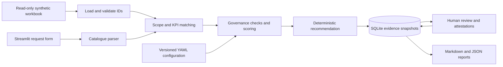

# Governed Analytics Decision Assistant

A local working prototype for Bayer's Since AI 2026 challenge, **Build Less, Build Better**. It searches the supplied synthetic BI estate before proposing reuse, remediation, consolidation or new content. Portfolio retirement is a separate, safeguarded workflow. Every decision has source evidence, explicit rules and a human review record.

**All supplied records are synthetic / illustrative, not Bayer performance data.** No production BI system or paid AI service is connected.

## Run locally

Python 3.11 or newer is required. From this project directory, on Windows:

```powershell
python -m venv .venv
.venv\Scripts\python.exe -m pip install -r requirements.txt
.venv\Scripts\python.exe -m streamlit run app.py
```

In the prepared workspace the environment already exists, so run only the last command. If `python` is a Windows Store placeholder, use an installed Python interpreter or `py -3` for the first command. On macOS/Linux replace `.venv\Scripts\python.exe` with `.venv/bin/python`.

Open http://localhost:8501. The server binds only to localhost. Keep the supplied XLSX in the project root under its original filename. The DOCX and PDF are requirements references, not runtime dependencies.

## Use the application

1. **Overview:** inspect asset/platform/lifecycle counts, possible duplicates, source rules and validation findings.
2. **Analytics Request:** choose a supplied request or enter text. Review the plain-language requirements table and check the confirmation box. Changing the request resets confirmation. Explicit fields can refine the intent. Contradictions require a recorded clarification or HUMAN REVIEW. A clarification is a human scope override, not automatic reconciliation.
3. **Decision Explanation:** start with the reason, accountable owner, unresolved questions and next action. Compare covered and missing KPIs. Expand candidates for score contributions, rule outcomes and original source rows. Download Markdown or JSON evidence. Scores are calculated indices; source records are facts; scope assumptions are separately labeled.
4. **Approvals:** approve, reject or request changes with a clearly labeled demo identity and comments. Approval requires an owner-review attestation. Consolidation/retirement also require dependency and business-impact attestations. Proposals with risks require acknowledgement of a remediation plan. HUMAN REVIEW cannot be approved until a revised recommendation is generated.
5. **Asset Explorer:** inspect source metadata, owners, KPIs, usage, lineage, signals and migration context. Submit a separate portfolio lifecycle proposal for review.

Reviewed snapshots are immutable through the app. To revise a decision, change the request and generate a new snapshot; prior records remain available. Approval authorizes a proposal only. The app never creates, changes or deletes BI content.

## Architecture and stack

Python, Streamlit, Pandas/openpyxl, YAML and SQLite. No separate frontend, vector store or orchestration framework.



`src/` separates loading, validation, parsing, matching, governance, scoring, decisions, persistence and reporting. `app.py` contains UI wiring only. See [architecture](docs/architecture.md) and [demo walkthrough](docs/demo.md).

## Matching and scoring

Catalogue names and a small explicit alias map identify products, markets and metrics. Country codes are matched case-sensitively to avoid interpreting ordinary words such as “us” as a country. Multiple scopes and conflicts are surfaced. Generic language that cannot be resolved needs explicit selectors.

Candidate assets must cover the requested product and market. `All Pharma` and `Global` are assumed supersets. A country asset cannot satisfy an entire-region request. KPI variants match through `canonical_metric`, but unapproved and noncanonical definitions still fail governance. Platform and model constraints are explicit compatibility gates; incompatible candidates remain visible.

Score = `100 × sum(component × weight) / sum(weights)`. Components are indices between 0 and 1, **not probabilities**:

| Component | Default weight | Formula |
| --- | ---: | --- |
| Product | 20 | 1 if scope covered, else 0 |
| Market | 20 | 1 if scope covered, else 0 |
| KPI | 35 | Distinct requested canonical metrics covered / requested count |
| Purpose | 5 | Purpose keywords present in asset title / purpose keyword count; 0 if unspecified |
| Governance | 10 | Passed source rule checks / eight checks |
| Freshness and quality | 5 | 1 for healthy model refresh and no attached quality issue, otherwise 0 |
| Usage | 5 | min(mean monthly unique users over latest three observations / 100, 1); 0 if missing |

Users are not summed across months. Usage is relative to the latest workbook month, not today's date. Unknown values score zero but remain explicitly unknown and can block reuse. Scores cannot override contradictions or governance gates. Configure weights and thresholds in `config/rules.yaml`; snapshots retain configuration content, version, hash, workbook SHA-256 and relevant source rows.

## Decision order

1. Missing request fields, unresolved text conflicts or serious dataset integrity errors → HUMAN REVIEW.
2. Full scope/KPI coverage, endorsement, no risks or missing evidence, and score at least 75 → REUSE.
3. Full coverage with incomplete/contradictory evidence → HUMAN REVIEW; known remediable problems → FIX.
4. Two compatible assets with some shared requested KPIs and complete union coverage → CONSOLIDATE, with remediation and impact review required.
5. Incomplete evidence on relevant matches → HUMAN REVIEW. A full business match on an incompatible platform/model also requires review before new build.
6. Partial coverage → FIX/extend an existing asset.
7. No KPI coverage in scope → BUILD NEW with a draft specification and semantic model candidates to assess. It is not a generated Power BI report. Missing metadata on zero-coverage assets does not imply those assets are invalid; known KPI mappings establish the coverage gap. Missing KPI maps still block this inference.

Potential duplicates require identical product/market scope and canonical KPI Jaccard similarity at least 0.75. This identifies overlap, not equivalent purpose. Retirement additionally requires candidate-retire lifecycle, low usage, a clean endorsed replacement covering all original metrics, limited audience, complete available evidence, and no recorded downstream dependency. Even then, human dependency-completeness and business-impact checks are mandatory.

## Governance rule mapping

All eight workbook rules are displayed with their original records. Their prototype operationalization is documented in [architecture](docs/architecture.md). Numeric thresholds are prototype assumptions, not Bayer policy. Signals and migration paths are scenario inputs, never official decisions. Absence of a signal is not treated as certification.

## Testing and reproducible demo

```powershell
.venv\Scripts\python.exe -m pytest -q
.venv\Scripts\python.exe scripts\demo.py
```

Tests cover source ingestion and IDs, parsing/conflicts, scope direction, scoring, every rule, all six actions, duplicate detection, retirement safeguards, no source mutation, persisted approvals, explanations, all five Streamlit pages and an approval surviving a fresh UI session. Controlled in-memory tests are labeled and derived from supplied records.

The demo writes reports and a separate SQLite database under ignored `runtime/demo/`. It verifies the original request contradiction, BUILD NEW using original workbook records, and REUSE after an explicitly labeled in-memory model-scope correction. It never alters the workbook. See the walkthrough for exact inputs and disclosure.

## Data findings and limitations

- The workbook contains 360 assets, 56 KPI definitions, 150 requests and eight rules. ID/reference validation identifies 21 missing asset-owner references. The app preserves them as missing evidence.
- REQ-0001 names Nubeqa/Global in text but Beyonttra/EMEA in structured fields. Asset/model product and region contradictions also occur; these block clean reuse.
- No clean REUSE example should be implied by altering the source. Controlled demonstrations explicitly disclose changes and identify the original workbook hash separately.
- Metadata and lineage are synthetic snapshots. No proof of dependency completeness, source access, business purpose equivalence or actual model measure coverage is available. Model candidates are suggestions for investigation, not certified implementations.
- Parsing is intentionally limited to catalogue names and documented aliases. No fuzzy semantic search, multilingual understanding or LLM integration is implemented.
- Conservative rules can return HUMAN REVIEW frequently. Consolidation searches pairs, not arbitrary larger groups. Purpose matching uses titles only; freshness uses supplied status, not live refresh timestamps.
- SQLite provides a local audit history, not tamper-proof enterprise records. Demo identities and checkbox attestations are not authentication or verified approval authority. This local app is not intended for multiuser production deployment.

## Optional Power BI project export

After the existing approval workflow, **Approvals → Optional final step: Power BI project draft** can prepare a ZIP containing a `.pbip` file, PBIR report folders and a TMSL semantic model. This is an isolated export; no decisions, workbook records or existing dashboards are modified. It supports approved request-level BUILD NEW and FIX only. For FIX it produces a draft for the existing owner, not an automatic replacement. Other actions retain the original evidence-report downloads.

The draft has two table pages: review notes and synthetic monthly values. It embeds the exact filtered snapshot, so it does not require credentials or local workbook paths. Supported KPIs are Net Sales, Units Shipped, Forecast Variance, Market Access Coverage, On-Time In-Full and Inventory Coverage. Each maps directly to a supplied `Product_Market_Monthly` column; the specification records source fields and units. These mappings are prototype mappings, not enterprise-certified measures. Unsupported KPIs, stale source hashes, missing values, unresolved requests or incompatible platform/model constraints block export. It never silently drops a requested KPI.

No aggregation or new DAX measure is invented. Product, market, month, value type and source Excel row remain visible. Actual-like and forecast-like records are not merged into totals. The result is a static snapshot; changing the workbook requires a new reviewed export.

**Validation limit:** Microsoft's bundled public schemas and model/visual references are checked offline. The complete TMSL model, M query execution and Desktop rendering have not been verified in Power BI Desktop. Treat the package as an experimental draft until that acceptance check passes; do not claim a fully tested Power BI report.

Try **Kerendia Inventory Coverage Italy** as a new request. The original workbook produces FIX. Review the evidence, record a demo approval with owner and remediation-plan attestations, then prepare the project ZIP. Extract everything to a short local path, open `Governed.pbip` in a current Power BI Desktop version supporting PBIP/PBIR, click **Refresh**, and compare the Data page against `evidence/source-rows.csv`. No publication happens automatically.

For a reproducible example in a separate demonstration database:

```powershell
.venv\Scripts\python.exe scripts\demo_pbip.py
```

Format references: [Microsoft PBIR report format](https://learn.microsoft.com/en-us/power-bi/developer/projects/projects-report), [semantic model project format](https://learn.microsoft.com/en-us/power-bi/developer/projects/projects-dataset). Export validation uses vendored schemas under `config/pbip_schemas`; see the upstream license there.

## Optional AI and enterprise extension

No credentials are needed, and no external AI calls are made. `.env.example` intentionally contains no required settings. Future optional language understanding should produce proposals only, retain deterministic decisions, and require explicit permission before sending data to a paid service.

Enterprise integration would use read-only Power BI/Tableau inventory, usage and lineage APIs, tenant authentication/RBAC, governed KPI sources and a controlled change-management integration. Validate API scope, ownership and retention policy before connecting. Replace demo reviewer identities with authenticated roles and append-only audited storage. Actual BI lifecycle execution must remain a separate approved process.

## Development Team:
1. Muhammad Irfan Haider Khan | MSc Data Science | Tampere University
2. Saif Ur Rehman | MDP ICT Data Analytics | University Of Turku 
